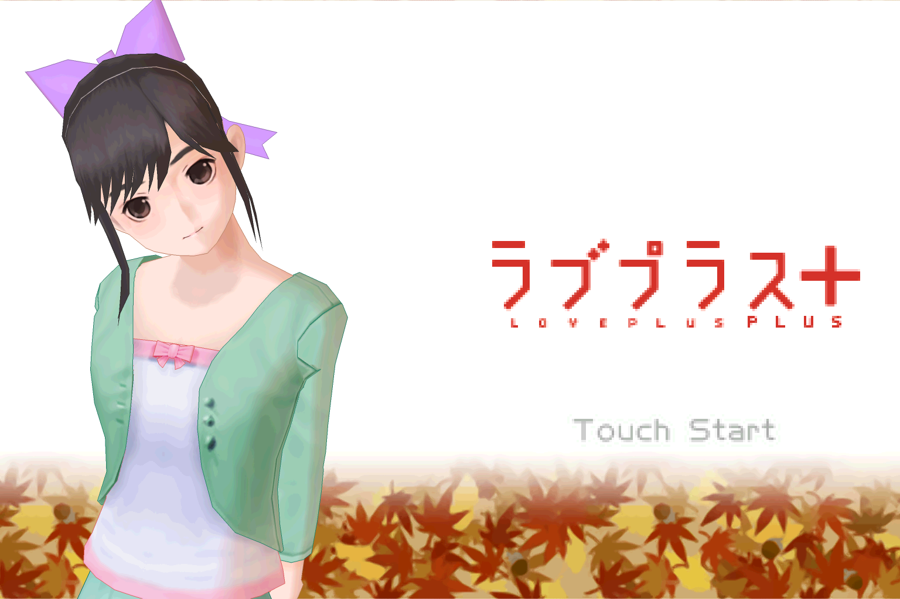
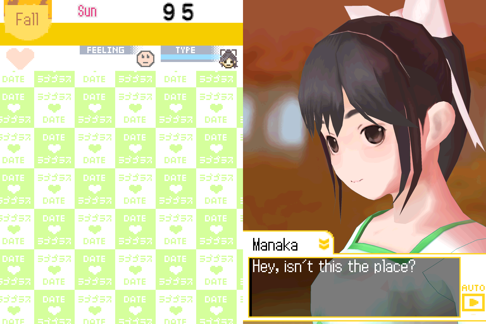
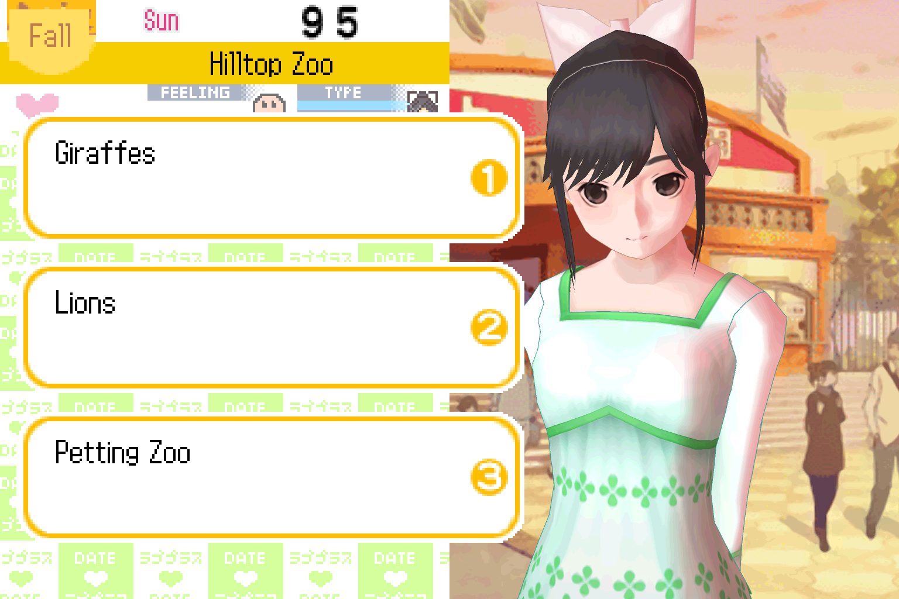
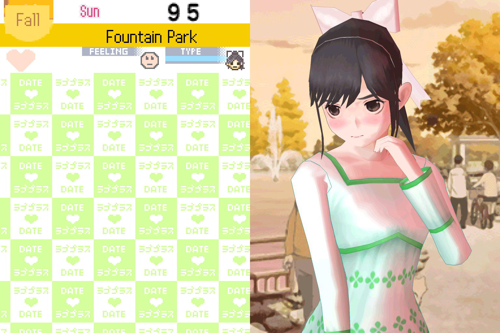
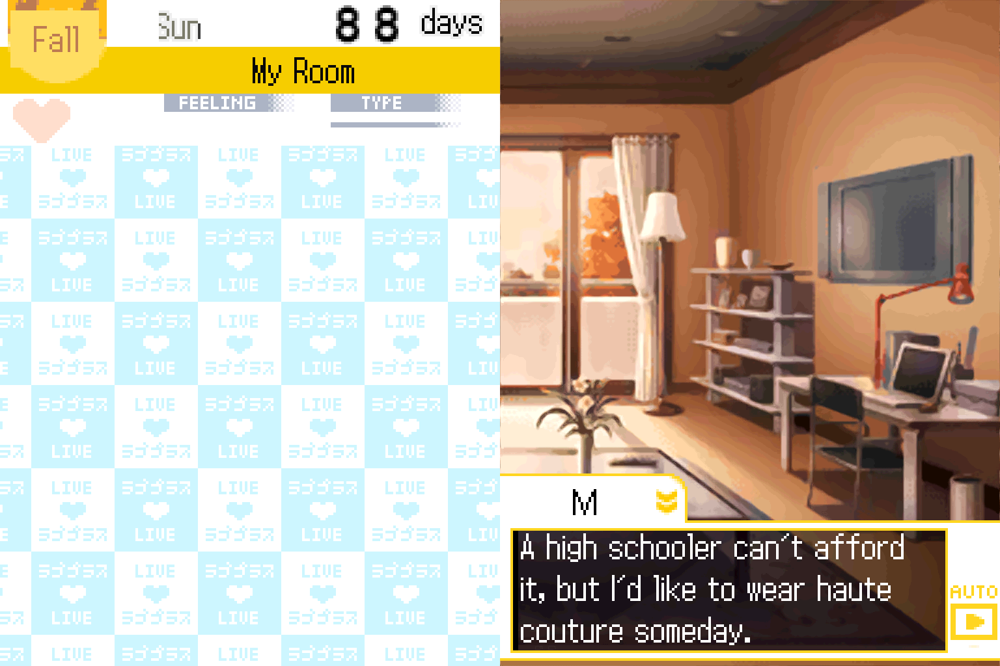
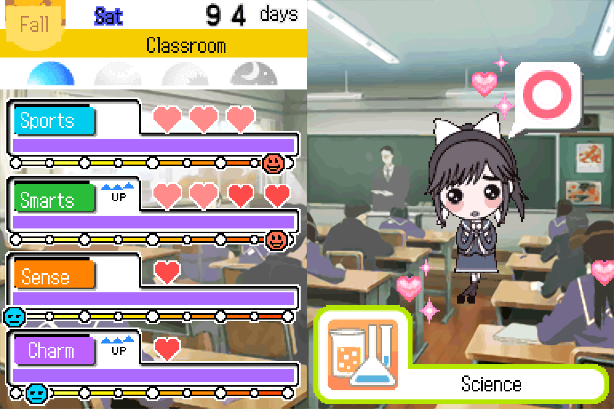

# lp-engine

**LovePlus+ (Konami, 2010) on PC and Mac, in English, sharper than it ever looked on a DS.**

lp-engine runs the Nintendo DS game *LovePlus+* from your own copy of the game, with a complete English translation
and modern rendering: up to 4× resolution, anti-aliasing, smoothed animation and upscaled textures. It isn't a general
DS emulator. It's an engine built around this one game: the game's own logic runs unchanged, and the hardware around
it (graphics, sound, touch screen, microphone, clock, saves) is reimplemented for your computer.

<table>
  <tr>
    <td></td>
    <td></td>
  </tr>
  <tr>
    <td></td>
    <td></td>
  </tr>
  <tr>
    <td></td>
    <td></td>
  </tr>
</table>

<sub>Captured from the engine at 4× resolution with texture filtering, smooth toon shading, anti-aliasing and
enhanced textures. The two screens sit side by side, the way the game is held.</sub>

## What you get

- **The whole game in English.** All 29,000 lines of dialogue, plus menus, messages and the game's drawn-in UI
  graphics, redrawn in its own pixel font. A few spots keep their Japanese on purpose (the vocabulary quiz, name
  readings).
- **A sharper picture.** The 3D is drawn at up to 4× resolution on your GPU, with optional anti-aliasing, texture
  filtering, smooth toon shading and 30 fps character animation. Textures and photo backgrounds can be upscaled (FSR,
  with a denoised "smooth" preset). The pixel-art UI stays crisp.
- **Real-time play, like the original.** The in-game clock follows your computer's clock, just as LovePlus+ followed
  the DS's. A Clock setting shifts it if your schedule doesn't match hers.
- **Everything the DS had:** the touch screen by mouse, buttons on the keyboard (rebindable) or a gamepad, the
  microphone for the moments she's listening, and closing the lid (minimize the window) to put the game to sleep.
- **Your saves are ordinary files.** Import a save from your cartridge or from DeSmuME (`.sav` / `.dsv`) and export
  it back.

## Getting started

You need your own dump of **LovePlus+ (Japanese release, game code BOXJ)** as an `.nds` file. lp-engine includes
nothing from the game: on first run it asks for your file and reads the game's data from it into its own folder. The
`.nds` file is never modified.

Download the build for your system from [Releases](https://github.com/gage-marshall/lp-engine/releases):

| system | download | how to run |
|---|---|---|
| macOS 11+ (Apple silicon or Intel) | `LovePlus+-…-macos.zip` | unzip, move **LovePlus+.app** to Applications, open it |
| Windows 10/11 (64-bit) | `LovePlus+-…-windows-x64.exe` | run it, no installer (a portable single file) |
| Linux (x86-64) | `loveplus_…_amd64.deb` or `LovePlus+-…-x86_64.AppImage` | `sudo apt install ./loveplus_…_amd64.deb`, or `chmod +x` the AppImage and run it |

The first start asks for your `.nds` file, then takes a few seconds to read it. After that the game starts straight
away.

### Controls

| DS | default key |
|---|---|
| touch screen | mouse on the right-hand screen |
| A / B / X / Y | X / Z / S / A |
| L / R | Q / W |
| Start / Select | Enter / Backspace |
| D-pad | arrow keys |

Keys can be changed under **Controls**, and gamepads work out of the box. **View** has the picture options, **Sound**
the volume, output device and microphone, and **Game** the save import / export, the lid, the clock and the English /
Japanese switch.

### Where things are kept

Game data, saves and settings live in a per-user folder (**Game > Show Game Folder** opens it):
`~/Library/Application Support/LovePlus+` on macOS, `%APPDATA%\LovePlus+` on Windows and `~/.config/loveplus` on
Linux. Your save is `saves/loveplus.sav`.

## Not supported

The wireless features (Talk Mode, card exchange, pass-by communication, save send / receive and transfer, regional
capsules) need a second DS. Choosing one shows a short notice and takes you back to the menu.

## Reporting a problem

Each play session is recorded quietly: the save it started from and your inputs, a few kilobytes. If the game's code
ever stops, the recording is kept and the app tells you where. Attaching it to an issue lets the exact session be
replayed, step for step. Turn on **Game > Keep Session Recordings** to keep them all.

## Building from source

The engine is Rust (`engine/`); the tools around it are Python (`tools/`).

```sh
cd engine
cargo build --release --bin game
./target/release/game                 # as released: first run asks for your .nds file
./target/release/game ../content      # development: run from an extracted content folder
```

`docs/RELEASE.md` covers the release packages. The rest of `docs/` is the reverse-engineering notes: the game's
flow, script VM, save format, rendering, audio and more.

| folder | what's in it |
|---|---|
| `engine/` | the engine and the game app (`src/bin/game.rs`), the extractor, the runtime, the renderer |
| `translation/` | the English translation: script and text tables, UI graphics relabels |
| `tools/` | extraction, translation and packaging tools |
| `docs/` | notes on how the game works |
| `sandbox/` | experiments behind the engine's rendering and flow work |

## Legal

lp-engine is released under the [MIT licence](LICENSE).

LovePlus is a trademark of Konami Digital Entertainment. This project is not affiliated with or endorsed by Konami
or Nintendo. It contains no game code or assets: everything game-related is read from the player's own copy at run
time, and the translation ships as a delta that applies only to that copy.

Voice playback uses an ITU-T G.722.1 Annex C decoder. Siren14™ / G.722.1C technology licensed from Polycom®, Inc.
The third-party libraries the program is built with, and their licences, are listed under **Help > Third-Party
Notices**.
